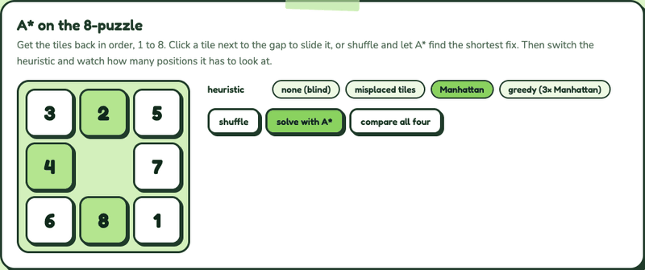

# A* Puzzle Solver

One A* search in C++ that solves five different puzzles: the 8-puzzle, the 15-puzzle, Klotski (Huarong Pass), Missionaries & Cannibals and 8-Queens.

## Demo



Recorded from the interactive demo on my portfolio, a JavaScript port of the 8-puzzle solver. [Try it in your browser](https://nicole-li7.github.io/projects/search.html).

## Features

- **One solver, five puzzles**: `astarSolve` never knows which puzzle it is solving. Each puzzle is a node class (`INode`) that lists its neighbours, gives a unique key for its state, and estimates its distance to the goal.
- **Shortest solutions**: the sliding puzzles use Manhattan distance, which never overestimates, so A* is guaranteed to return the shortest path.
- **Heuristics matter**: a weaker estimate like misplaced tiles still finds the shortest path but looks at far more positions; an inflated one (3x Manhattan) turns A* greedy, which is much faster but can return a longer path.
- **Step-by-step output**: each solver prints every state along the solution (8-Queens prints the finished board).

## Getting started

Open `astar.slnx` in Visual Studio and run the `astar` project. It solves each puzzle in turn and prints the steps to the console.

## How it's built

```
astar/astar/
  astar/        INode interface and the A* solver
  puzzle8/      8-puzzle
  puzzle15/     15-puzzle
  klotski/      Klotski (Huarong Pass)
  missionaries/ Missionaries & Cannibals
  queens8/      8-Queens
  astar.cpp     runs every solver and prints the results
```

See also [minimax](https://github.com/nicole-li7/minimax), the game-playing half of the same project.
